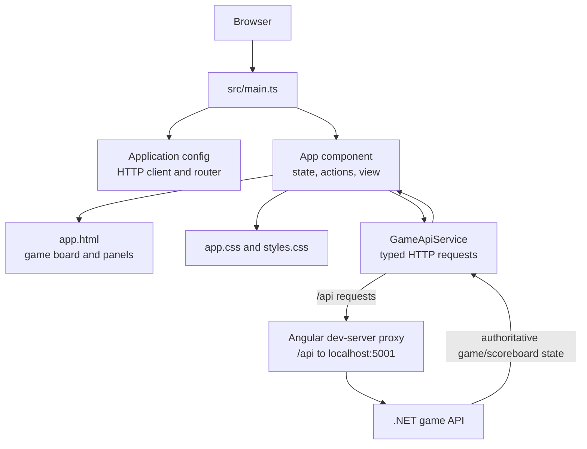

# UI Architecture and Flow

## Scope

This document describes the Tic Tac Toe browser UI: its Angular entry point, component structure, state handling, and interactions with the game API. The API owns game rules and persistent session state; the UI renders the state returned by the API and sends user actions.

## Architecture

### Main parts

| Part | Responsibility |
| --- | --- |
| `src/main.ts` | Bootstraps the standalone Angular `App` component with the application configuration. |
| `src/app/app.config.ts` | Provides Angular's HTTP client, router, and browser error listeners. |
| `src/app/app.ts` | Holds reactive UI state, starts sessions, validates whether actions can be made, calls the API service, and applies API responses. |
| `src/app/app.html` | Renders the mode selector, status, board, game actions, scoreboard, and move history. |
| `src/app/app.css` | Styles the game and side panels and adapts their layout for smaller screens. |
| `src/app/game-api.service.ts` | Defines the API data types and sends typed HTTP requests. It does not implement game rules. |
| `src/proxy.conf.json` | For local development, forwards `/api` requests to `http://localhost:5001`. |
| `src/app/app.spec.ts` | Tests the component using mocked HTTP responses. |

## State ownership and rendering

The component stores the latest server response in Angular signals:

- **Session/game:** `sessionId`, `gameMode`, `board`, `currentPlayer`, `gameStatus`, `winner`, and `winningCells`.
- **History and score:** `moveHistory` and `scoreboard`.
- **Request/UI feedback:** `requestPending` and `scoreboardMessage`.

The API response is the source of truth. On a successful game action, `applyState()` updates the session ID and all displayed game fields together. The component does not calculate wins, draws, computer moves, or scores locally.

The template derives the displayed state from these signals. It highlights winning cells, renders each move's row and column, and shows a status message for the current turn, a win, a draw, or a pending request.

## User and API flows

### Start or change mode

1. Angular bootstraps `App`; `ngOnInit()` starts a two-player game.
2. `startGame(mode)` marks the request as pending and calls `POST /api/games` with `{ "mode": mode }`.
3. The API returns a complete `GameState`; `applyState()` stores and renders it.
4. Selecting a different mode starts a new session using the same flow. Selecting the already active mode does nothing.

### Make a move

1. A board cell is enabled only when a session exists, no request is pending, the game is `playing`, the cell is empty, and (in computer mode) it is the human player's turn (`X`).
2. Clicking an enabled cell calls `POST /api/games/{gameId}/moves` with `{ "position": n }`, where `n` is the zero-based cell index.
3. While waiting, `requestPending` prevents additional moves.
4. The returned state replaces the current UI state. The board, active player, history, scoreboard, and terminal status therefore stay consistent with the API.

### Undo a move

1. Undo is disabled when there are no moves or the game is not in the `playing` state.
2. When available, undo calls `POST /api/games/{gameId}/undo`.
3. The API's returned game state replaces the component state.

### Reset the current game

The reset-game action calls `POST /api/games/{gameId}/reset`. The returned state is applied in the same way as a move or undo. Resetting a game is distinct from resetting the session scoreboard.

### Reset the scoreboard

The scoreboard action calls `POST /api/scoreboard/reset`. On success, the component updates the scoreboard and displays a confirmation message. It does not change the current board or move history.

### Errors and pending requests

Game requests set `requestPending` while in flight. On success, applying the server response clears it. On failure, the UI displays an action-specific server error through `scoreboardMessage` and clears the pending state so the user can retry. If the initial game request fails, the message instructs the user to start the .NET API.

## API contract used by the UI

`GameApiService` uses relative `/api` URLs. In local development, the Angular dev server forwards these to the backend target in `src/proxy.conf.json`.

| Operation | Request |
| --- | --- |
| Create game | `POST /api/games` — `{ mode }` |
| Make move | `POST /api/games/{gameId}/moves` — `{ position }` |
| Undo | `POST /api/games/{gameId}/undo` — empty JSON object |
| Reset game | `POST /api/games/{gameId}/reset` — empty JSON object |
| Reset scoreboard | `POST /api/scoreboard/reset` — empty JSON object |

Game operations return a `GameState` containing the session ID, mode, board, current player, status, winner, winning cells, moves, and scoreboard. The scoreboard reset returns a `Scoreboard`.

## Accessibility and responsive behavior

- The board uses grid semantics, and each cell has an accessible label that includes its row, column, and mark when occupied.
- Status updates are placed in an `aria-live="polite"` region.
- Buttons use native disabled states when an action is unavailable.
- The desktop layout places the board and supporting panels side by side; CSS media queries stack these panels on narrower screens.

## Local development and verification

- Start the UI with `npm start` (Angular dev server).
- Ensure the .NET API is available at `http://localhost:5001` for proxied `/api` requests.
- Build with `npm run build`.
- Run the UI tests with `npm test`.
